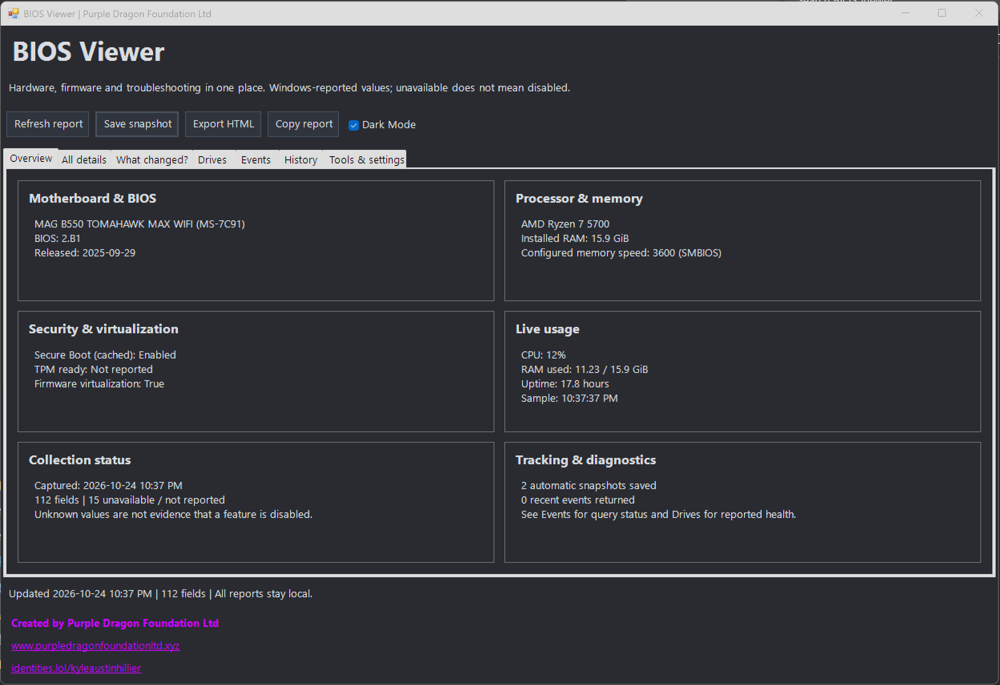

# BIOS Viewer

Created by **Purple Dragon Foundation Ltd**
- https://www.purpledragonfoundationltd.xyz/
- https://identities.lol/kyleaustinhillier

## Screenshot

## Download

On GitHub, choose **Code > Download ZIP**, then extract the ZIP before opening the app. Alternatively, clone this repository. This repository contains the portable app source; it does not include personal hardware reports or saved preferences.

## VirusTotal scan

[View the VirusTotal report for BIOSViewer-v1.0.0.zip](https://www.virustotal.com/gui/file/e0dc7a0180496a6b3b860b22ece291f2b8ef803b94937dc0cca30d6ab1ee8da8).

The report checked on October 24, 2026 showed **0/64 detections**, with no security vendors flagging the ZIP as malicious. Some other engines timed out, failed, or could not process the file type. This is a scan result for the specific release ZIP, not a guarantee of safety or coverage of future versions.

SHA-256: `e0dc7a0180496a6b3b860b22ece291f2b8ef803b94937dc0cca30d6ab1ee8da8`

## Open the app

Double-click **Open BIOS Viewer.cmd**. Keep the app files together. Requires Windows PowerShell 5.1, included with Windows. No installation, third-party packages, or network connection is required. Clicking the website/profile links opens your default browser.

If a previous version is open, close that window and open the launcher again to load the new version.

## What's included

- **Overview:** motherboard/BIOS, processor and memory, security and virtualization, collection status, tracking summary, and live CPU/RAM/uptime.
- **All details:** full report with search and section filters. Includes firmware, memory modules, graphics driver version, volumes, and sleep/wake information.
- **What changed?:** compare your current report with an older snapshot. Shows added, changed, and removed fields. Hide routine changes excludes last boot, free disk space, drive temperature, power-on hours, power queries, and event query summaries. Permissions and query availability can also cause differences.
- **Drives:** Windows-reported drive health, operational status, and free space. Temperature, wear, hours, and error counters appear only when the device/controller and permissions allow them.
- **Events:** the last seven days of WHEA hardware errors and Kernel-Power event 41 shutdowns, capped at 50 per category. Double-click an event for its full message. No matching events is not proof of fault-free hardware; Kernel-Power 41 does not identify the cause of a shutdown.
- **History:** automatic snapshots after each full refresh, with a 30-file limit. Select a row and click Compare selected. The newest previous snapshot is used as the initial comparison on startup.
- **Tools & settings:** shortcuts to System Information, Device Manager, Event Viewer, Reliability Monitor, Windows Security, Power settings, and Storage settings. Toggles control automatic history and live usage sampling.

## Saving and sharing

**Save snapshot** exports JSON for later comparison. Existing version-one snapshots remain supported. Some firmware repeats memory slot labels; repeated fields are preserved as separate entries, matched by occurrence rather than discarded.

**Export HTML** saves a standalone, readable report that opens in a browser. **Copy report** copies the full information table as text. Events are included in JSON/HTML reports, while clipboard export contains the information table.

The data folder beside the app contains preferences.json and history/. Theme, window size, and monitoring/history preferences are remembered when the app closes. Dark Mode is the initial default. Automatic retention applies only to files with the app's exact generated naming pattern in history/; manually saved reports are outside that retention policy. Turning history off stops future automatic saves and keeps existing files.

Reports stay local unless you share them. Hardware details and event messages may reveal information about your PC. Serial numbers and product keys are not deliberately collected.

## Reading limitations

The tool reads Windows CIM/SMBIOS hardware information, Windows storage providers, Secure Boot state, TPM status, event logs, performance counters, and read-only powercfg queries. Missing/denied values remain unknown, not disabled. A reported Healthy drive is not a complete SMART diagnosis. Zero-valued drive sensors can mean unsupported. Configured RAM speed does not prove that A-XMP is enabled, and reported maximum CPU clock is not a live boost measurement.

Some queries require administrator privileges. To run with those permissions, open Windows PowerShell as administrator, navigate to this folder, and run:

    powershell.exe -NoProfile -STA -ExecutionPolicy Bypass -File ".\BIOS Viewer.ps1"

The launcher uses a process-local execution policy option; it does not change the persistent Windows execution policy. The app never elevates itself automatically. Queries run in background workers; full collection has a 120-second limit, live samples a 25-second limit. Live sampling is approximately every five seconds after the previous sample completes and pauses when minimized. Closing the app stops its workers. There is no startup task or background service.

A-XMP profiles, PBO, firmware boot priority, fan curves, CPU temperature, and CPU voltages are not exposed by this version. It does not write firmware settings, install drivers, apply updates, restart the PC, or change power plans. Native Windows title bars, tab headers, drop-down lists, and file dialogs may follow the system theme.

## Community and licensing

BIOS Viewer is released under the [MIT License](LICENSE), copyright 2026 Purple Dragon Foundation Ltd.

- [Contributing guidelines](CONTRIBUTING.md)
- [Code of Conduct](CODE_OF_CONDUCT.md)
- [Security policy and private vulnerability reporting](SECURITY.md)
- [Accessibility statement](ACCESSIBILITY.md)
- [Report a bug, request a feature, or report an accessibility barrier](https://github.com/bubblegump30/BIOSViewer/issues/new/choose)
